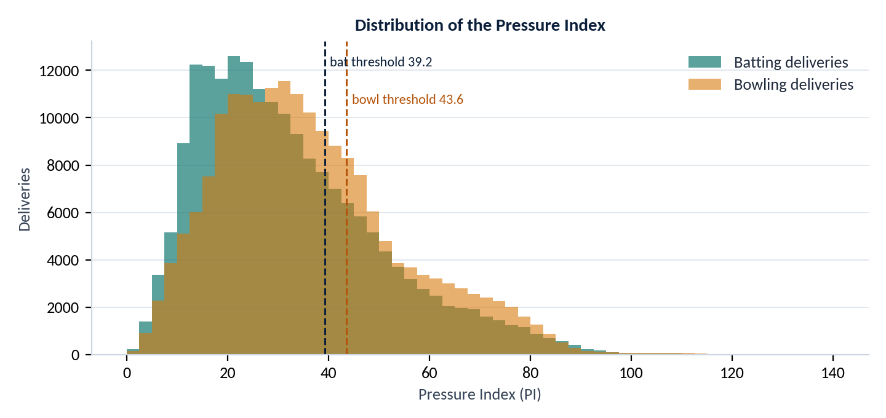
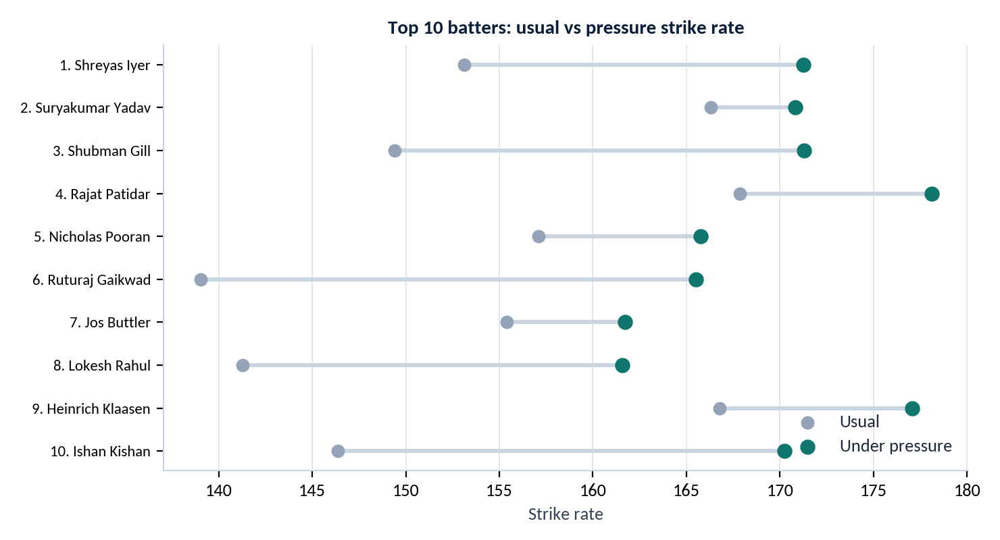
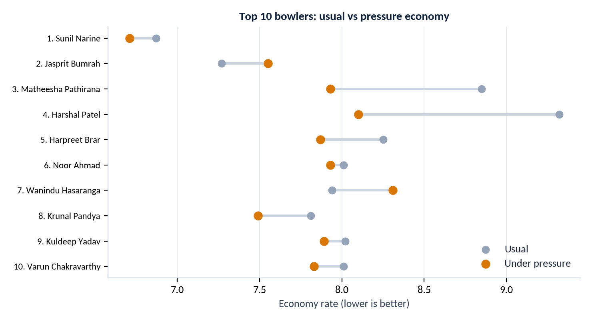
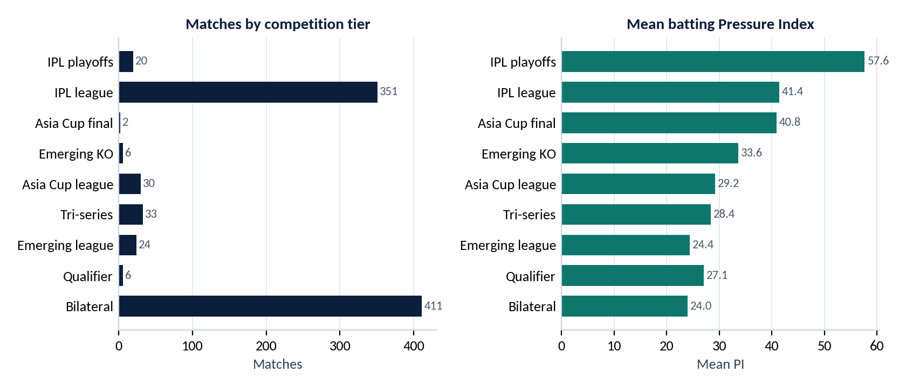

# SupeRR Selector Season 2 — Round 1

## Identifying the most reliable players under pressure

**Submission type:** data-driven player rankings + methodology report  
**Data:** IPL 2022–2026 and T20 Internationals 2022–2026 supplied in the Round 1 data pack  
**Coverage:** 883 matches, 200,961 deliveries, 2022–2026

---

## 1. Executive summary

We build a **Pressure Index (PI)** for every delivery from three ingredients:

1. **Match stakes** — a competition/stage weight that follows the requested ladder:
   bilateral and Asia Cup group games < IPL league < IPL playoffs, with the Asia Cup final
   deliberately kept below IPL league level rather than treated as a World Cup stand-in.
2. **Opponent strength** — the opponent's pre-match Elo rating, used as a dynamic proxy for
   the ICC T20I ranking because the supplied pack contains no ranking file.
3. **Situational pressure** — a calibrated win-probability model converts runs left, balls
   left, wickets remaining and the pre-match Elo gap into the chance the batting side wins.
   Pressure peaks when the contest is genuinely in the balance and is damped in dead games.

Each player's output in the top 30% highest-pressure deliveries — with a soft ramp around the
cutoff — is then measured against a **level-weighted expectation**: 85% the neutral situation
par and 15% the player's own usual level. The score is weighted by PI, shrunk for sample size
and adjusted for how often the player delivered a positive pressure innings. Putting most of
the weight on situation par means an elite player is judged mainly against the difficulty of
the situation rather than only against their own high bar, while the 15% own-baseline term
still rewards genuine improvement. The final lists are in Sections 5.1 and 5.2.

> **Headline result.** **Shreyas Iyer** and **Sunil Narine** lead the batting and bowling
> lists. The ranking is 85% a level test against situation par and 15% an improvement test
> against the player's own baseline, with a 400-ball floor and sample-size shrinkage.

**Headline selections**

| Rank | Batter | Score | Bowler | Score |
|---:|---|---:|---|---:|
| 1 | Shreyas Iyer | +0.333 | Sunil Narine | +0.196 |
| 2 | Suryakumar Yadav | +0.330 | Jasprit Bumrah | +0.170 |
| 3 | Shubman Gill | +0.329 | Matheesha Pathirana | +0.165 |
| 4 | Rajat Patidar | +0.318 | Harshal Patel | +0.163 |
| 5 | Nicholas Pooran | +0.286 | Harpreet Brar | +0.136 |

The full top 10s, with pressure strike rates, economies, sample sizes and consistency, are in
Sections 5.1 and 5.2.

---

## 2. What the data contains

| File | Use |
|---|---|
| `ball_by_ball.csv` | Delivery-level outcome, batter, bowler, extras, dismissal |
| `matches.csv` | Competition, date, venue, teams, result, revised targets/overs |
| `competitions.csv` | Competition name, format and season |
| `teams.csv` | Team names |
| `playing_eleven.csv`, `competition_team_player_mapping.csv` | Player/team context (not needed for the core ratings) |

**Coverage by season.** The pack spans five calendar years and two formats. Every delivery
is used, including those outside the pressure set, because the own-baseline and situation-par
estimates need the full population.

| Season | Matches | Deliveries |
|---|---:|---:|
| 2022 | 168 | 39,627 |
| 2022/23 | 12 | 2,838 |
| 2023 | 137 | 32,249 |
| 2023/24 | 3 | 739 |
| 2024 | 198 | 44,289 |
| 2024/25 | 3 | 754 |
| 2025 | 216 | 47,383 |
| 2026 | 146 | 33,082 |

The pack contains **no ICC Men's T20 World Cup**. The senior multi-nation tournament present
is the **Asia Cup** (2022 and 2025); the development equivalents are the **Emerging Teams Asia
Cup 2024** and **Asia Cup Rising Stars 2025**. Because the pack has no World Cup, and because
the Asia Cup is not given World-Cup-level weight in this submission, all Asia Cup events sit
**below IPL league level** in the stakes ladder. The requested ordering is therefore preserved
where the data allows it: bilateral < IPL league < IPL playoffs, with the Asia Cup final above
bilateral cricket but below an IPL league match.

---

## 3. Defining pressure

### 3.1 Match stakes (S)

Every match is assigned a tier from its competition name and stage:

| Tier | Weight | Examples in the pack |
|---|---:|---|
| Bilateral T20I | 0.6 | England in Pakistan T20I Series |
| Qualifier | 0.6 | Asia Cup T20 Qualifiers |
| Emerging league | 0.6 | Emerging Teams Asia Cup group |
| Tri-series | 0.7 | New Zealand T20I Tri Series |
| Asia Cup league | 0.7 | Asia Cup group / Super 4 |
| Emerging knockout | 0.75 | Emerging Asia Cup semi/final |
| Asia Cup final | 0.85 | Asia Cup final |
| IPL league | 1.0 | IPL 2022–2026 league stage |
| IPL playoff | 1.4 | Qualifier, Eliminator, Final |

This reproduces the requested ordering: bilateral < IPL league < IPL playoffs. The Asia Cup is
not elevated to the missing World Cup rung; its league stage is weighted alongside a tri-series
and its final sits above bilateral cricket but below IPL league level. IPL matches therefore
carry the highest stakes in the pack, and IPL playoffs carry the highest weight overall.

### 3.2 Opponent strength (O)

The pack has no ICC ranking table, so we compute a **pre-match Elo rating** for every team from
the results in the same data, separately for the IPL and international pools. The opponent's
pre-match Elo is converted to a 0–1 strength and mapped to a multiplier:

```
O = 0.80 + 0.40 * strength(opponent Elo)
```

so a player faces at most a ±20% stakes adjustment for opponent quality. Elo is updated after
each match (K = 24.0, home advantage = 20.0 Elo points). Using a
dynamic Elo rather than a single static ranking snapshot is deliberate: it tracks form and
opponent strength at the time of the match, and it is fully reproducible from the supplied data.

### 3.3 Situational pressure (P)

An earlier version of this model measured closeness with hand-set run-rate terms. That has a
known failure mode: in a chase that is already won (20 needed off 30 with eight wickets in
hand) the batting side is “ahead of par”, so a naive mirror-image formula calls it high bowling
pressure, while a genuine death-over squeeze (45 off 18 with four wickets) can score low. We
therefore replace the hand-set closeness terms with a **win-probability model fitted on the
supplied ball-by-ball data**.

For every delivery, before the ball is bowled, we form a small state vector:

- `adv` — the projected final score minus the target (2nd innings) or the venue par score
  (1st innings), divided by 20;
- `lost` — wickets already lost, divided by 10;
- `elapsed` — legal balls bowled divided by the innings length;
- `elo_diff` — the batting team's pre-match Elo minus the bowling team's, divided by 400;
- the interaction `adv * elapsed` and a constant.

A separate logistic model is fitted for each innings (`p = sigmoid(w · x)`), with the label
“did the batting team win?” and L2 regularisation. The fitted coefficients are:

| Innings | adv | lost | adv × elapsed | Elo diff | constant |
|---|---:|---:|---:|---:|---:|
| First | +0.64 | -0.70 | -0.06 | +1.64 | +0.35 |
| Second | +0.62 | -1.25 | +1.81 | +0.78 | +0.63 |

The model is used only to **order situations by leverage**, not as a claim that a player caused
a win-probability change. Leverage is the classic `4p(1-p)` term, which is 1 when the game is a
coin-flip and 0 when it is decided. We damp it early in the innings, when every game is still
nominally close but little has been decided:

```
p = sigmoid(w · x)
tension = 4 * p * (1 - p) * (0.4 + (1 - 0.4) * elapsed)
```

The two roles then get a different resources term, and — importantly — that term is **gated by
tension**:

```
wk_bat  = clip(wickets_lost / 9, 0, 1)      # a batter is under pressure when wickets fall
wk_bowl = clip(wickets_left / 10, 0, 1)     # a bowler is under pressure when wickets remain
P_bat   = tension * (0.5 + 0.25 * wk_bat)  + 0.25 * elapsed
P_bowl  = tension * (0.5 + 0.25 * wk_bowl) + 0.25 * elapsed
```

Gating the resources term is what removes the dead-game distortion completely. Wickets only
create pressure while the match is alive: once `p` has collapsed, `tension` goes to zero and
the resource term vanishes with it. The only term that survives a decided game is the small
late-innings term, which is why such deliveries fall below the pressure threshold instead of
inflating a bowler's tally.

Two worked chases (target 160, par 8.5) show the effect. A cakewalk — 20 needed off 30 with
eight wickets in hand — has `p ≈ 0.93`, `tension ≈ 0.22`, and scores **PI_bowl ≈ 34**. A
genuine squeeze — 45 needed off 18 with four wickets — has `p ≈ 0.10`, `tension ≈ 0.32`, and
scores **PI_bowl ≈ 41**. The tight chase now ranks higher for the bowler, which is the correct
ordering. A knife-edge game (`p ≈ 0.50`) has `tension ≈ 1.00` and dominates both. Runs left,
balls left and wickets remaining all still enter through the win-probability model and the
`elapsed` / resources terms, so the brief's situational inputs remain explicit.

### 3.4 Entry context

The situation a player walks into matters. For every innings we record the PI of the **first
ball faced by the batter** and the **first ball bowled by the bowler**. Each pressure delivery
weight is multiplied by

```
1 + 0.15 * entry_PI / 100
```

so a player who enters at 20/3 in the fifth over, or comes on in the death overs of a tight
chase, carries a modest additional weight through that innings. This directly implements the
“when the batter came in / when the bowler came on” requirement.

### 3.5 Pressure Index and threshold

The per-delivery index is

```
PI = 100 * S * O * P
```

PI is unbounded above; the observed range is about 0–137. A delivery is **core pressure** if
it is in the **top 30% of PI for that role** (70th percentile). In this dataset the thresholds
are:

| Role | 70th-percentile threshold | Pressure deliveries |
|---|---:|---:|
| Batting | 39.2 | 57,978 of 193,250 balls faced |
| Bowling | 43.6 | 57,733 of 192,411 legal balls |



The percentile threshold defines the core pressure set, but the score does not use a hard
cutoff: Section 4.4 describes the soft logistic ramp that lets deliveries just below the
threshold contribute partial weight. Section 6 shows how sensitive the lists are to moving the
threshold.

---

## 4. Measuring performance

### 4.1 Baselines and expected performance

For each player we compute two expectations:

1. **Own baseline** — the player's overall runs per ball (batting) or runs conceded per legal
   ball (bowling) across the whole dataset. This is the “usual level” the brief asks for.
2. **Situation par** — the phase-specific par rate at the same point of the innings, adjusted
   for the venue. Phases are powerplay (first 30% of the innings), middle (30–75%) and death
   (last 25%). The fitted values are:

| Phase | Batting runs/ball | Batting wicket rate | Bowling runs/ball | Bowling wicket rate |
|---|---:|---:|---:|---:|
| Powerplay | 1.3552 | 0.0453 | 1.3550 | 0.0447 |
| Middle | 1.3258 | 0.0478 | 1.3257 | 0.0472 |
| Death | 1.5964 | 0.0824 | 1.5955 | 0.0781 |

The blended baseline used in the rating is

```
base = 0.85 * situation_par + (1 - 0.85) * own_baseline
```

With `α = 0.85`, this is **85% situation par and 15% own baseline**. For
batting, the per-ball impact can be written as

```
impact = 0.85 * (actual - par) + (1 - 0.85) * (actual - own)
```

and for bowling the signs reverse:

```
impact = 0.85 * (par - conceded) + (1 - 0.85) * (own - conceded)
```

So 85% of the judgement is the **level test** — did the player beat what a typical player would
be expected to do in that exact situation? — and 15% is the **improvement test** — did the player
beat their own usual level? Under the old 50/50 blend the own baseline carried half the weight,
which let a modest relative improver outrank an elite player who merely maintained an already
high level. At 85/15 the level test has clear precedence, while the own-baseline term stays
large enough that a player far above their own history still gains. Setting the weight to 1.0 would drop the own
baseline entirely and make the score pure performance against situation par; 0.85 deliberately
keeps a 15% improvement signal.

### 4.2 Batting impact

For every pressure ball faced:

```
impact_i = (runs_off_bat - base_runs_per_ball) - wv_i * (out - base_wicket_rate)
```

The wicket value is no longer a flat 5 runs. It varies with the phase, the dismissed batter's
position in the order, and how set that batter is:

```
wv_i = 5.0 * order_mult * phase_mult * (1 + 0.4 * clip(batter_runs / 30, 0, 1))
```

`order_mult` runs from 1.60 for an opener to 0.20 for a No. 11; `phase_mult` is
1.2 in the powerplay, 1.0 in the middle and 1.05
at the death. Across the pack the average wicket value is about 7.5 runs, but the spread is
wide: a top-order powerplay wicket is worth roughly 10–13 runs, while a tailender dismissed in
the 20th over is worth roughly 1.5–3. This stops the model treating a wicket at 20/3 and a
wicket at 180/8 as the same event. The per-ball impacts are weighted by PI and the entry
factor.

### 4.3 Bowling impact

For every pressure legal ball:

```
impact_i = (base_runs_per_ball - runs_conceded) + wv_i * (wicket - base_wicket_rate)
```

A bowler is rewarded for conceding fewer runs than expected and for taking wickets above
expectation. The same per-ball wicket value applies to the bowling side: taking the wicket of a
set top-order batter is worth more than taking a tailender's. Byes and leg-byes are excluded
from runs conceded; wides and no-balls are included; wides and no-balls do not count as legal
balls.

### 4.4 Weighting, shrinkage and consistency

The score does not use a hard in/out cutoff. A delivery just below the 70th percentile is not
obviously less pressure than one just above it, so each delivery receives a soft weight:

```
soft_i = sigmoid((PI_i - threshold) / tau)
w_i = PI_i * soft_i * (1 + 0.15 * entry_PI / 100)
```

with `tau = 0.1 * threshold` (about 3.9 batting and
4.4 bowling PI points).
Deliveries down to `threshold - 2*tau` are included with a small weight; below that they are
dropped. The **core** pressure count (used for eligibility and the tables) still counts only
deliveries at or above the 70th percentile, so the soft band cannot be used to manufacture a
qualifying sample.

The raw pressure score is the weighted mean impact:

```
raw = sum(w_i * impact_i) / sum(w_i)
```

Small samples are noisy, so the score is shrunk towards zero:

```
ppi = raw * sum(w_i) / (sum(w_i) + 600.0)
```

With K = 600, a player with 400 core pressure balls keeps about
400 / (400 + 600) ≈ 0.40 of the raw impact, while
one with 900 keeps 0.60. Combined with the 400-ball eligibility
floor below, this prevents a short hot streak from topping a list. The full rankings also
report the standard error, `effective_balls` and `reliability` as diagnostics.

Finally, we measure **consistency**: the share of a player's pressure innings (minimum
6 pressure balls) in which the player's impact was positive. The final
score is

```
final = ppi * (1 - 0.2 + 0.2 * consistency)
```

so a player who repeatedly delivers in pressure innings is preferred to one with the same
average but a boom-or-bust record.

### 4.5 Eligibility

| Rule | Batters | Bowlers |
|---|---:|---:|
| Minimum total balls | 400 | 400 |
| Minimum pressure balls | 400 | 400 |
| Minimum pressure innings | 5 | 5 |

These thresholds leave **44 eligible batters** and
**42 eligible bowlers**. They deliberately exclude short cameos: a
player must have faced at least 400 core pressure deliveries (or
bowled 400) to enter a list. This floor removes thin but
eye-catching records. With the floor switched off, **Vaibhav Sooryavanshi** (93 pressure
balls) would top the batting list, followed by **Najibullah Zadran** (102) and
**Rilee Rossouw** (120); **Quinton de Kock** (268) would sit seventh. On the bowling side
**Dushan Hemantha** (57) and **Hasan Mahmud** (57) would lead. None of these is a fair
comparison with a 700-ball body of work, so the floor excludes them. Every player in the final
top 10 has at least
424 pressure balls, so all clear the
floor comfortably.

Per the submission instruction, players representing **Pakistan** or **Pakistan A**
(65 players in the pack) are excluded from both rankings. Their
deliveries remain in the underlying data only as opposition context; no Pakistani player can
appear in either top 10.

---

## 5. Results

### 5.1 Top 10 batters under pressure

| Rank | Player | Team | Pressure balls | SR usual | SR pressure | SR par | Final score | Consistency |
|---:|---|---|---:|---:|---:|---:|---:|---:|
| 1 | Shreyas Iyer | India | 696 | 153.14 | 171.26 | 150.15 | +0.333 | 0.511 |
| 2 | Suryakumar Yadav | India | 881 | 166.29 | 170.83 | 144.75 | +0.330 | 0.627 |
| 3 | Shubman Gill | Gujarat Titans | 756 | 149.39 | 171.3 | 147.99 | +0.329 | 0.435 |
| 4 | Rajat Patidar | Royal Challengers Bengaluru | 557 | 167.86 | 178.1 | 148.75 | +0.318 | 0.533 |
| 5 | Nicholas Pooran | Lucknow Super Giants | 815 | 157.1 | 165.77 | 148.94 | +0.286 | 0.534 |
| 6 | Ruturaj Gaikwad | Chennai Super Kings | 464 | 139.02 | 165.52 | 139.58 | +0.278 | 0.486 |
| 7 | Jos Buttler | Rajasthan Royals | 781 | 155.39 | 161.72 | 150.62 | +0.276 | 0.5 |
| 8 | Lokesh Rahul | Lucknow Super Giants | 781 | 141.29 | 161.59 | 145.98 | +0.272 | 0.486 |
| 9 | Heinrich Klaasen | Sunrisers Hyderabad | 933 | 166.76 | 177.06 | 154.85 | +0.224 | 0.585 |
| 10 | Ishan Kishan | India | 524 | 146.37 | 170.23 | 144.65 | +0.221 | 0.405 |



### 5.2 Top 10 bowlers under pressure

| Rank | Player | Team | Pressure balls | Econ usual | Econ pressure | Econ par | Wkts | Final score | Consistency |
|---:|---|---|---:|---:|---:|---:|---:|---:|---:|
| 1 | Sunil Narine | Kolkata Knight Riders | 1006 | 6.87 | 6.71 | 8.66 | 48 | +0.196 | 0.621 |
| 2 | Jasprit Bumrah | Mumbai Indians | 677 | 7.27 | 7.55 | 9.27 | 36 | +0.170 | 0.509 |
| 3 | Matheesha Pathirana | Chennai Super Kings | 573 | 8.85 | 7.93 | 9.15 | 41 | +0.165 | 0.538 |
| 4 | Harshal Patel | Royal Challengers Bengaluru | 896 | 9.32 | 8.1 | 9.29 | 59 | +0.163 | 0.525 |
| 5 | Harpreet Brar | Punjab Kings | 424 | 8.25 | 7.87 | 8.76 | 22 | +0.136 | 0.484 |
| 6 | Noor Ahmad | Chennai Super Kings | 784 | 8.01 | 7.93 | 8.55 | 44 | +0.128 | 0.543 |
| 7 | Wanindu Hasaranga | Sri Lanka | 688 | 7.94 | 8.31 | 8.54 | 43 | +0.127 | 0.475 |
| 8 | Krunal Pandya | Lucknow Super Giants | 879 | 7.81 | 7.49 | 8.34 | 42 | +0.090 | 0.463 |
| 9 | Kuldeep Yadav | Delhi Capitals | 1135 | 8.02 | 7.89 | 8.65 | 64 | +0.069 | 0.623 |
| 10 | Varun Chakravarthy | Kolkata Knight Riders | 972 | 8.01 | 7.83 | 8.7 | 48 | +0.041 | 0.551 |



### 5.3 Reading the lists

- **Shreyas Iyer** tops the batting list: 696 pressure balls across
  45 pressure innings, a strike rate of 171.26
  against a usual 153.14 and a phase/venue par of 150.15. Both
  components are positive — 0.2502 runs per ball from scoring and
  0.1241 runs per ball from wickets — and the lead survives sample-size
  shrinkage and the consistency adjustment (0.511).
- **Suryakumar Yadav** and **Shubman Gill** are effectively tied for second and third
  (0.330 vs 0.329). Surya has
  881 pressure balls at a strike rate of 170.83
  against a usual 166.29 and par 144.75; Gill has
  756 balls at 171.3 against
  149.39 and par 147.99. Surya's consistency
  (0.627) is the highest in the batting top 10; Gill's is lower
  (0.435) and his run impact is marginally smaller
  (0.2707 vs 0.2738).
- **Rajat Patidar** is fourth with the highest run impact in the list
  (0.3425 per ball) and a pressure strike rate of
  178.1, but on a smaller sample (557 balls) and
  with almost no wicket impact (0.014).
- **Nicholas Pooran** is fifth (815 balls, pressure strike rate
  165.77 against 157.1 usual and
  148.94 par), with the third-best wicket impact among batters
  (0.129). **Ruturaj Gaikwad** and **Jos Buttler** follow in sixth and
  seventh; Buttler's wicket impact (0.1591) is the best among the batters.
- **Lokesh Rahul** is eighth (781 balls, 161.59
  against 141.29 usual), **Heinrich Klaasen** ninth and **Ishan Kishan** tenth.
  Klaasen has the second-highest pressure strike rate (177.06) and the
  largest batting sample (933 balls), but his own baseline is already
  166.76 and par is 154.85, so under the level-weighted bar
  his margin is smaller than the raw strike rate suggests. Ishan has a strong run impact
  (0.2975) but a negative wicket impact (-0.041) and the
  lowest consistency in the top 10 (0.405), which is why he sits tenth.
- **Sunil Narine** tops the bowling list with 1006 pressure balls, an
  economy of 6.71 against a usual
  6.87 and a par of 8.66. His run impact is
  0.2539 per ball; the wicket component is slightly negative
  (-0.04), so his pressure wicket rate is a little below the blended bar,
  but his run suppression and consistency (0.621) carry him to first.
- **Jasprit Bumrah** is second (677 balls). His pressure economy
  of 7.55 is worse than his own usual
  7.27 but far better than the situation par of
  9.27, giving him the best run impact in the list
  (0.2643 per ball). The wicket component is
  -0.0738: his pressure wicket rate is below the situation par, even
  though his raw wicket tally is high. Under the level-weighted blend his run suppression is
  enough for second; he is no longer judged mainly against his own elite baseline.
- **Matheesha Pathirana** and **Harshal Patel** are third and fourth
  (0.165 vs 0.163). Pathirana has the better
  absolute economy (7.93 against
  8.85 usual and 9.15 par); Harshal has the
  larger sample (896 balls against 573) and a
  bigger improvement over his own level. Both have positive wicket impacts
  (0.0396 and 0.0297).
- **Harpreet Brar**, **Noor Ahmad** and **Wanindu Hasaranga** fill fifth to seventh. Hasaranga
  has the best wicket impact in the list (0.1008) but concedes more than his
  own baseline (8.31 against
  7.94), so his rank reflects the balance of the two components.
  **Krunal Pandya**, **Kuldeep Yadav** and **Varun Chakravarthy** complete the top 10; Kuldeep
  has the highest consistency in the bowling top 10 (0.623), while Varun's
  negative wicket impact (-0.0458) leaves him tenth despite a large sample.
- The list is not simply a death-bowling award. Narine and Bumrah lead on run suppression across
  phases, while Pathirana and Harshal supply the death-over wicket threat. Brar, Noor and
  Krunal remain top-10 on large middle-overs samples, but the pressure model discounts tidy
  spells in games that are already decided.
- **What the 85/15 change did.** Moving from the old 50/50 blend to 85/15 raises Bumrah from
  fifth to second and drops Harshal from first to fourth; Narine inherits first. On the batting
  side Suryakumar Yadav rises from sixth to second, Klaasen enters at ninth and Pant drops out.
  This is the intended effect of giving the level test clear precedence over relative
  improvement.

## 6. Reliability and sensitivity

**Consistency check.** The `consistency` column is the fraction of pressure innings with a
positive impact. The top-10 batters range from
0.41 to 0.63;
the top-10 bowlers range from
0.46 to 0.62.
No player reaches the top of a list on one extraordinary innings alone.

**Sensitivity.** Re-running the pipeline with different modelling choices keeps the leading
names but reshuffles the lower half of each top 10 (Jaccard overlap of the top-10 sets against
the base run):

| Variant | Batting overlap | Bowling overlap |
|---|---:|---:|
| Wicket value 2 instead of 5 | 1.00 | 1.00 |
| Wicket value 8 instead of 5 | 0.67 | 0.82 |
| Pressure = top 20% (not 30%) | 0.54 | 0.82 |
| Pressure = top 40% (not 30%) | 0.82 | 0.54 |
| Absolute weight 0.70 (not 0.85) | 0.82 | 0.82 |
| Absolute weight 1.00 (not 0.85) | 0.82 | 1.00 |
| Soft ramp tau 0.05 (not 0.10) | 1.00 | 1.00 |
| Soft ramp tau 0.20 (not 0.10) | 1.00 | 0.82 |

The lists are stable in composition at the top and more volatile in the lower half. Halving the
wicket value reproduces both top-10 sets exactly (the order changes); doubling it changes two
batting names and one bowling name, because it rewards wicket-taking over economy. Moving the level/improvement
blend to 0.70 or 1.00 keeps the same leading group and changes at most two names, which is the
expected behaviour: the blend changes the order and the back half, not the identity of the
best pressure players. The soft-ramp variants reproduce almost all of the base list. The
biggest movement comes from moving the pressure threshold to the top 20% or top 40%, which
changes what counts as pressure at all; even there the overlap is 0.54–0.82 rather than the
0.25 seen before the soft ramp. The lower half of each list should therefore be read as a
shortlist rather than a precise ordering.

> **Robustness.** The leading group is stable across every variant. The biggest movement
> comes from changing what counts as pressure, not from the level/improvement weight.

### Tier evidence

Pressure is not spread evenly across the calendar, and the tier weights show up in the data
before any player is scored. The mean PI rises from bilateral cricket to the IPL playoffs, and
the share of deliveries above the pressure threshold rises with it.

| Tier | Matches | Batting balls | Mean batting PI | Mean bowling PI | Pressure share |
|---|---:|---:|---:|---:|---:|
| Bilateral | 411 | 86,477 | 24.0 | 26.6 | 10% |
| Qualifier | 6 | 1,334 | 27.1 | 30.1 | 14% |
| Emerging league | 24 | 5,325 | 24.4 | 27.1 | 13% |
| Tri-series | 33 | 7,328 | 28.4 | 32.1 | 21% |
| Asia Cup league | 30 | 6,780 | 29.2 | 32.9 | 24% |
| Emerging KO | 6 | 1,410 | 33.6 | 35.9 | 37% |
| Asia Cup final | 2 | 475 | 40.8 | 45.2 | 47% |
| IPL league | 351 | 79,628 | 41.4 | 46.9 | 51% |
| IPL playoffs | 20 | 4,493 | 57.6 | 65.2 | 75% |



The table is the ladder made visible. IPL playoffs carry a mean batting PI of
57.6 and place 75% of deliveries
above the pressure threshold, against 41.4 and
51% in IPL league matches and 24.0 and
10% in bilateral cricket. The Asia Cup final
(40.8 batting,
45.2 bowling) lands just below the IPL league,
exactly where the de-weighted ladder places it: above bilateral cricket, but not promoted to a
World Cup stand-in. The same ordering holds for bowling, where the playoff mean is
65.2 against 46.9 in the
league stage.

Two consequences follow. The ladder is doing real work: the gaps are wide enough to survive
the win-probability and opponent adjustments. But because the IPL supplies
371 of the 883 matches,
most of the high-pressure sample is IPL cricket. That is a property of the data pack, not a
thumb on the scale, but the lists are IPL-weighted evidence rather than a balanced global
sample.

---

## 7. Limitations

1. **No ICC World Cup in the pack.** The requested World Cup rung cannot be measured directly.
   The Asia Cup is present but is deliberately **not** treated as a World Cup substitute: it is
   weighted below IPL league level. If an ICC World Cup is added later, the tier mapping is a
   one-line change in `pipeline.py`.
2. **No official ICC ranking file.** Opponent strength uses a pre-match Elo rating computed
   from the same data. This is dynamic and reproducible, but it is a proxy, not the official
   ranking table.
3. **Pressure is a model, not a ground truth.** The 70th percentile defines the core pressure
   set and the soft ramp smooths the boundary; Section 6 shows the effect of moving both.
   Different weights produce somewhat different lists, which is why every parameter is
   documented in `outputs/config.json`. The score is measured against a level-weighted
   expectation (85% situation par, 15% the player's own baseline), so it is not a pure level
   ranking: 15% of the weight still rewards improvement on the player's own history, and a
   large relative jump can therefore move a player above a more established name. The
   `impact_runs` and `impact_wickets` columns make that trade-off visible for every player,
   and Section 6 shows how the lists respond when the weight is moved to 0.70 or 1.00.
4. **Sample sizes remain uneven.** A player with 400 core pressure balls has a wider
   uncertainty band than one with 900. The 400-ball floor and shrinkage reduce but do not
   eliminate this; the `pressure_balls`, `effective_balls` and `consistency` columns should be
   read alongside the rank.
5. **No player-level matchup quality.** Team strength is captured by pre-match Elo, but T20
   pressure is also matchup-driven: facing Bumrah and Rashid Khan in a tight chase is not the
   same as facing part-time bowlers in the same game state. The pack has no player-level Elo or
   matchup file, so this remains a documented limitation rather than a modelled input.
6. **The win-probability model is descriptive.** It is fitted on the same data and is used to
   order situations by leverage, not to claim that a player caused a particular
   win-probability change. It is a calibration device, not an externally validated forecasting
   model.
7. **Selection and role effects.** All-rounders can appear in both lists if they meet the
   volume thresholds. The lists are pressure-performance lists, not a claim about overall T20
   greatness.
8. **Rain and revised matches.** Revised targets and revised innings lengths are taken from
   `matches.csv` (the `*_revised_overs` fields store balls, not overs; this was verified
   against the delivery counts). Super overs are excluded.
9. **Pakistani players excluded.** Per the submission instruction, players representing
   Pakistan and Pakistan A are removed from the rankings. Under the current 400-ball floor no
   Pakistani player would have entered either top 10 anyway, so the exclusion does not change
   the submitted lists; it is applied as an explicit guard rather than an implicit one.
10. **Player labels.** Names are exactly as they appear in the data pack (for example
    “Namboori Tilak Varma”). The Unstop dropdowns may use shorter labels; map them carefully
    before submitting.

## 8. Reproducibility

```
python3 pipeline.py        # builds ratings and top-10 files
python3 sensitivity.py     # runs the sensitivity variants
python3 make_report.py     # builds charts and this report
```

| Output | Contents |
|---|---|
| `outputs/top10_batters.csv` | Final top 10 batters |
| `outputs/top10_bowlers.csv` | Final top 10 bowlers |
| `outputs/player_pressure_ratings_bat.csv` | Full eligible batting rankings |
| `outputs/player_pressure_ratings_bowl.csv` | Full eligible bowling rankings |
| `outputs/ball_pressure.csv` | Per-delivery PI and outcome (audit trail) |
| `outputs/summary.json` | Thresholds, phase par, tier counts and full config |

All parameters live in the `CFG` dictionary at the top of `pipeline.py`; `outputs/config.json`
records the exact values used for the submitted lists.
